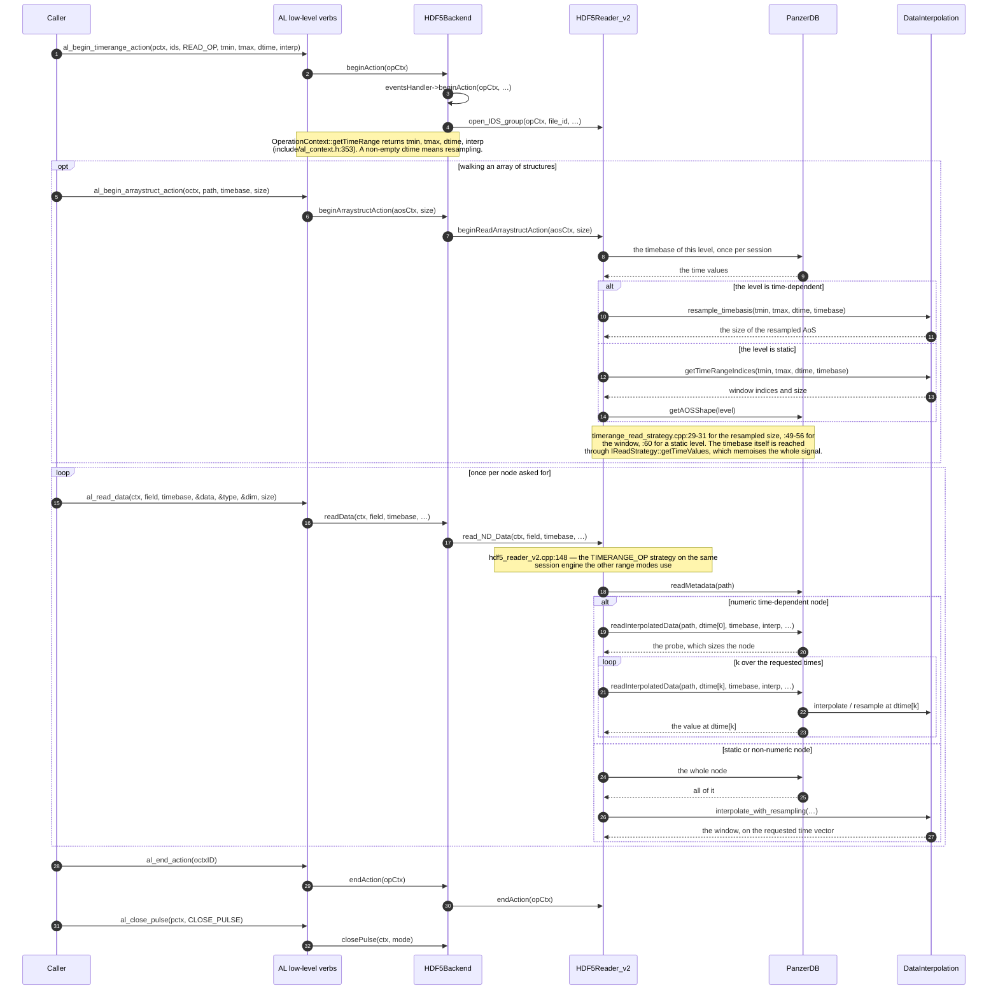

# PanzerDB (HDF5 backend v2) — sequence diagrams of the five high-level verbs

> `put()`, `get()`, `put_slice()`, `get_slice()`, `getSample()` as they reach
> `src/hdf5/`. **Only public interface operations appear as arrows**: the `Backend`
> pure virtuals (`include/al_backend.h`), the public methods of `HDF5Writer_v2`,
> `HDF5Reader_v2` and `PanzerDB`, and the three `IReadStrategy` virtuals. Internal
> helpers (`prepare_strategy`, `select_strategy`, `writeDataSlicesImpl`,
> `read_dataset_globally`, `restoreTimeContext`, …) appear as notes only, because they
> are not what a caller or a new backend has to implement.
>
> No raw HDF5 call (`H5Dread`, `H5Sselect_hyperslab`) is shown either — the point of
> these diagrams is the contract between the four public layers, not where the bytes
> land. Verified against `13ad876` (2026-10-22).

---

## 1. Who is who

| Participant | What it is | Public surface used below |
|---|---|---|
| **Caller** | the IMAS high-level layer (`ids_put` / `ids_get` / `ids_put_slice` / `ids_get_slice` / `ids_getSample`) | the AL verbs |
| **AL low-level verbs** | `include/al_lowlevel.h:268-491` | `al_begin_dataentry_action`, `al_begin_global_action`, `al_begin_slice_action`, `al_begin_timerange_action`, `al_begin_arraystruct_action`, `al_write_data`, `al_read_data`, `al_end_action`, `al_close_pulse` |
| **HDF5Backend** | `src/hdf5/hdf5_backend.cpp`, concrete `Backend` | `openPulse:184`, `beginAction:282`, `writeData:250`, `readData:255`, `beginWriteArraystructAction:270`, `beginReadArraystructAction:277`, `endAction:330`, `closePulse:225` |
| **HDF5Writer_v2 / HDF5Reader_v2** | the v2 write and read sessions | `setWriteStrategy`, `write_ND_Data`, `beginWriteArraystructAction`, `endAction`, `closePulse`, `deleteData` / `open_IDS_group`, `read_ND_Data`, `beginReadArraystructAction`, `endAction`, `release_session` |
| **PanzerDB** | the storage engine | `beginArray`, `endArray`, `writeData`, `writeDataSlices`, `writeMetadata`, `flush`, `close`, `reanchor`, `getLeaves`, `getAOSShape`, `getWholeDynamicSignal`, `readMetadata`, `readInterpolatedData`, `readLeavesUnion`, `readTensor` |
| **DataInterpolation** | shared AL time-interpolation component (`include/data_interpolation.h`) | `getTimeRangeIndices`, `resample_timebasis`, `interpolate`, `interpolate_with_resampling` |

`DataInterpolation` is there because the backend declares itself interpolation-capable
(`supportsTimeDataInterpolation` / `supportsTimeRangeOperation`), which makes the AL
install the component at backend creation (`src/al_backend.cpp:88-89`).

### Which verb becomes which call

| AL verb | `Backend` virtual | Where it goes in v2 |
|---|---|---|
| `al_begin_dataentry_action` (`:268`) | `openPulse` (`al_backend.h:66`) | `hdf5_backend.cpp:184` — the label in `master.h5` picks the v1 or v2 reader/writer |
| `al_begin_global_action` (`:477`) | `beginAction` (`:87`) | `GLOBAL_OP`: `create_IDS_group` + `setWriteStrategy(GLOBAL_OP)` (`hdf5_events_handler.cpp:24-25`) for a write, `open_IDS_group` (`:67`) for a read |
| `al_begin_slice_action` (`:479`) | `beginAction` (`:87`) | `SLICE_OP`: `open_IDS_group` + `setWriteStrategy(SLICE_OP)` (`:34-35`) for a write, `open_IDS_group` (`:67`) for a read |
| `al_begin_timerange_action` (`:481`) | `beginAction` (`:87`) | `TIMERANGE_OP`, reads only: `open_IDS_group` (`:67`) |
| `al_begin_arraystruct_action` (`:485`) | `beginArraystructAction` (`:164`) | `hdf5_backend.cpp:270` (write) / `:277` (read) |
| `al_write_data` (`:489`) | `writeData` (`:113`) | `HDF5Writer_v2::write_ND_Data` (`hdf5_backend.cpp:252`) |
| `al_read_data` (`:487`) | `readData` (`:138`) | `HDF5Reader_v2::read_ND_Data` (`hdf5_backend.cpp:258`) |
| `al_end_action` (`:483`) | `endAction` (`:95`) | `hdf5_backend.cpp:330` → the events handler routes it to the writer (`hdf5_events_handler.cpp:79`/`:89`) or the reader (`:81`/`:96`), then `close_group` (`:91`/`:98`) |
| `al_close_pulse` (`:279`) | `closePulse` (`:78`) | `hdf5_backend.cpp:225` → reader `:242` or writer `:244` |

`al_delete_data` (`:422`) is not one of the five verbs but follows the same shape:
`Backend::deleteData` → `HDF5Writer_v2::deleteData` (`hdf5_writer_v2.cpp:499`), which
releases the engine first because the base class is about to unlink the datasets that
engine holds handles on.

---

## 2. The five verbs

### 2.1 `put()` — `GLOBAL_OP` write

One fresh `PanzerDB(WRITE)` engine for the whole IDS; everything the AL writes goes
through `write_ND_Data`, and the file is finished when the action ends.

```mermaid
sequenceDiagram
    autonumber
    participant C as Caller
    participant AL as AL low-level verbs
    participant BE as HDF5Backend
    participant W2 as HDF5Writer_v2
    participant PZ as PanzerDB

    C->>AL: al_begin_dataentry_action(uri, FORCE_CREATE_PULSE)
    AL->>BE: openPulse(ctx, mode)
    Note over BE: hdf5_backend.cpp:184 — reads the pulse label, picks the backend<br/>generation, creates the pulse

    C->>AL: al_begin_global_action(pctx, "core_profiles", "", WRITE_OP)
    AL->>BE: beginAction(opCtx)
    BE->>BE: eventsHandler->beginAction(opCtx, …)
    BE->>W2: create_IDS_group(opCtx, …)
    BE->>W2: setWriteStrategy(opCtx, GLOBAL_OP, loc_id)
    W2->>PZ: PanzerDB(loc_id, WRITE)
    Note over W2: hdf5_writer_v2.cpp:91 then :99-100 — a GLOBAL_OP write always<br/>builds a fresh engine and drops the previous one. The @key map<br/>scraped from IDSDef.xml is built once here.

    loop once per node of the IDS
        C->>AL: al_write_data(octx, field, timebase, data, type, dim, size)
        AL->>BE: writeData(ctx, field, timebase, …)
        BE->>W2: write_ND_Data(ctx, field, timebase, …)
        Note over W2: hdf5_writer_v2.cpp:195 — '/' becomes '&'; the timebase decides<br/>the branch, and the schema replay adds the @key leaves
        alt node with no timebase (static)
            W2->>PZ: writeData(name, shape, data)
        else node with a timebase (time-dependent)
            W2->>PZ: writeDataSlices(name, shape, data, …)
        end
        opt the node has schema attributes
            W2->>PZ: writeMetadata(path + "@" + key, value)
        end
    end

    opt the node sits inside an array of structures
        C->>AL: al_begin_arraystruct_action(octx, path, timebase, size)
        AL->>BE: beginArraystructAction(aosCtx, size)
        BE->>W2: beginWriteArraystructAction(aosCtx, size)
        W2->>PZ: beginArray(name, size) — static AoS
        W2->>PZ: beginArray(name, timebase) — dynamic AoS
        Note over W2,PZ: a dynamic AoS takes its size from the timebase, a static one<br/>from the caller. An empty AoS never reaches this call<br/>(hdf5_backend.cpp:272).
    end

    C->>AL: al_end_action(octxID)
    AL->>BE: endAction(opCtx)
    BE->>W2: endAction(opCtx)
    W2->>PZ: endArray() — once per open AoS level
    W2->>PZ: flush() — the commit point
    W2->>PZ: close()
    Note over W2,PZ: hdf5_writer_v2.cpp:475 flushes, then :482 closes because the mode<br/>is WRITE. A put() leaves a finished file behind.

    C->>AL: al_close_pulse(pctx, CLOSE_PULSE)
    AL->>BE: closePulse(ctx, mode)
    BE->>W2: closePulse(ctx, mode, …)
    Note over BE: a session that rewrote the layout re-labels master.h5 here<br/>(hdf5_backend.cpp:238) so the next open picks the right reader
```

### 2.2 `get()` — `GLOBAL_OP` read

The whole node, every time slice. The read session keeps one engine for the whole
session, so the second `get()` on the same pulse does not re-decode `/index`.

```mermaid
sequenceDiagram
    autonumber
    participant C as Caller
    participant AL as AL low-level verbs
    participant BE as HDF5Backend
    participant R2 as HDF5Reader_v2
    participant PZ as PanzerDB

    C->>AL: al_begin_dataentry_action(uri, OPEN_PULSE)
    AL->>BE: openPulse(ctx, mode)
    Note over BE: hdf5_backend.cpp:184 — the label decides the reader

    C->>AL: al_begin_global_action(pctx, "core_profiles", "", READ_OP)
    AL->>BE: beginAction(opCtx)
    BE->>BE: eventsHandler->beginAction(opCtx, …)
    BE->>R2: open_IDS_group(opCtx, file_id, …)
    Note over R2: hdf5_reader_v2.cpp:53 — the session engine and its decoded<br/>index are deliberately NOT dropped when a new group opens

    opt walking an array of structures
        C->>AL: al_begin_arraystruct_action(octx, path, timebase, size)
        AL->>BE: beginArraystructAction(aosCtx, size)
        BE->>R2: beginReadArraystructAction(aosCtx, size)
        R2->>PZ: getAOSShape(level)
        PZ-->>R2: the effective size of the AoS
    end

    loop once per node asked for
        C->>AL: al_read_data(octx, field, timebase, &data, &type, &dim, size)
        AL->>BE: readData(ctx, field, timebase, …)
        BE->>R2: read_ND_Data(ctx, field, timebase, …)
        Note over R2: hdf5_reader_v2.cpp:148 — '/' becomes '&', then the GLOBAL_OP<br/>strategy is chosen (:86). The engine is moved onto this operation's<br/>group id (reanchor, :92) instead of rebuilt; only a refusal rebuilds it.
        R2->>PZ: getLeaves()
        PZ-->>R2: the cached leaf table
        R2->>PZ: readMetadata(path)
        PZ-->>R2: the node's @key attributes
        alt several leaves for one node (time slices, AoS elements)
            R2->>PZ: readLeavesUnion(leaves, buffer, dtype)
        else a single leaf
            R2->>PZ: readTensor(leaf, buffer)
        end
        PZ-->>R2: the values
        R2-->>BE: 1 on success, 0 when the node is not there (include/al_backend.h:135)
    end

    C->>AL: al_end_action(octxID)
    AL->>BE: endAction(opCtx)
    BE->>R2: endAction(opCtx)
    Note over R2: hdf5_reader_v2.cpp:76 — delegated only when this context owns the<br/>group; the engine itself stays open for the next operation

    C->>AL: al_close_pulse(pctx, CLOSE_PULSE)
    AL->>BE: closePulse(ctx, mode)
    BE->>R2: closePulse(ctx, mode, …)
```

### 2.3 `put_slice()` — `SLICE_OP` write

The distinctive part: the `APPEND` engine is built by the **first** slice of the session
and every later slice re-anchors the same one. `endAction` commits and keeps it alive.

```mermaid
sequenceDiagram
    autonumber
    participant C as Caller
    participant AL as AL low-level verbs
    participant BE as HDF5Backend
    participant W2 as HDF5Writer_v2
    participant PZ as PanzerDB

    C->>AL: al_begin_dataentry_action(uri, OPEN_PULSE)
    AL->>BE: openPulse(ctx, OPEN_PULSE)

    loop one put_slice() per time slice
        C->>AL: al_begin_slice_action(pctx, "core_profiles", WRITE_OP, t, interp)
        AL->>BE: beginAction(opCtx)
        BE->>BE: eventsHandler->beginAction(opCtx, …)
        BE->>W2: open_IDS_group(opCtx, …)
        BE->>W2: setWriteStrategy(opCtx, SLICE_OP, loc_id)
        alt first slice of the session
            W2->>PZ: PanzerDB(loc_id, APPEND)
            Note over W2,PZ: hdf5_writer_v2.cpp:131 — adopts the index layout already in the<br/>file rather than writing the newest one
        else a later slice of the same session
            W2->>PZ: reanchor(loc_id)
            Note over W2,PZ: hdf5_writer_v2.cpp:130 — the engine built by the first slice is<br/>reused. An APPEND accepts the move only while the row count<br/>still equals the next row it would write, so rows another writer<br/>added in between force a rebuild.
        end

        C->>AL: al_write_data(octx, field, timebase, data, type, dim, size)
        AL->>BE: writeData(ctx, field, timebase, …)
        BE->>W2: write_ND_Data(ctx, field, timebase, …)
        W2->>PZ: writeDataSlices(name, shape, data, …)
        Note over W2,PZ: one /index row per signal per call; the time anchor of the row is<br/>computed here, and a signal that already exists gets a second row<br/>rather than an edit of the first.

        C->>AL: al_end_action(octxID)
        AL->>BE: endAction(opCtx)
        BE->>W2: endAction(opCtx)
        W2->>PZ: flush() — the commit point of this slice
        Note over W2,PZ: hdf5_writer_v2.cpp:475 then :482 — no close(): the engine, its<br/>handles, its decoded table and HDF5's write chunk cache survive to<br/>the next put_slice(). The order inside flush() is payloads, then<br/>/path_table, then /list_spans, then /index — never the reverse.
    end

    C->>AL: al_close_pulse(pctx, CLOSE_PULSE)
    AL->>BE: closePulse(ctx, mode)
    BE->>W2: closePulse(ctx, mode, …)
    W2->>PZ: released here, not before
    Note over W2,PZ: hdf5_writer_v2.cpp:490 with the reset at :494 — releasing the engine<br/>before the base class closes the pulse is what keeps HDF5 from<br/>segfaulting at library termination.
```

### 2.4 `get_slice()` — `SLICE_OP` read

One time slice, at the requested instant. The time is resolved to a slice index by the
engine, which is also where a missing slice becomes the closest available one.

```mermaid
sequenceDiagram
    autonumber
    participant C as Caller
    participant AL as AL low-level verbs
    participant BE as HDF5Backend
    participant R2 as HDF5Reader_v2
    participant PZ as PanzerDB
    participant IN as DataInterpolation

    C->>AL: al_begin_slice_action(pctx, "core_profiles", READ_OP, t, LINEAR_INTERP)
    AL->>BE: beginAction(opCtx)
    BE->>BE: eventsHandler->beginAction(opCtx, …)
    BE->>R2: open_IDS_group(opCtx, file_id, …)

    opt walking an array of structures
        C->>AL: al_begin_arraystruct_action(octx, path, timebase, size)
        AL->>BE: beginArraystructAction(aosCtx, size)
        BE->>R2: beginReadArraystructAction(aosCtx, size)
        R2->>PZ: getAOSShape(level)
        PZ-->>R2: the effective size of the AoS
    end

    loop once per node asked for
        C->>AL: al_read_data(ctx, field, timebase, &data, &type, &dim, size)
        AL->>BE: readData(ctx, field, timebase, …)
        BE->>R2: read_ND_Data(ctx, field, timebase, …)
        Note over R2: hdf5_reader_v2.cpp:148 — the SLICE_OP strategy is chosen on the<br/>session engine (reanchored at :92), shared by every range mode
        R2->>PZ: readMetadata(path)
        R2->>PZ: readInterpolatedData(path, t, timebase, interp, …)
        Note over PZ: slice_read_strategy.cpp:114. The time is turned into a slice index<br/>through the node's timebase; a slice that is not there is resolved by<br/>nearestAvailableSliceIndex (panzerdb.h:1109) and the covering rows<br/>come from rowsForTime (panzerdb.h:488).
        opt interp is LINEAR_INTERP and the two neighbours exist
            PZ->>IN: interpolate(previous, next, t)
            IN-->>PZ: the slice at t
        end
        PZ-->>R2: one slice, shape without the time axis
    end

    C->>AL: al_end_action(octxID)
    AL->>BE: endAction(opCtx)
    BE->>R2: endAction(opCtx)
    C->>AL: al_close_pulse(pctx, CLOSE_PULSE)
    AL->>BE: closePulse(ctx, mode)
```

### 2.5 `getSample()` — `TIMERANGE_OP` with a requested time vector

> **On the name.** `getSample` is not a symbol in this tree — the only mention is the
> title of `tests/hdf5_backend/test_al_resampling_user_vector.cpp` ("getSample
> equivalent"). The high-level `getSample(times)` verb is a `TIMERANGE_OP` read whose
> `OperationContext` carries a `dtime` vector plus an interpolation mode; that vector is
> the only thing that distinguishes it from a plain time-range read.



---

## 3. Session state the five verbs walk through

| | `put()` | `get()` | `put_slice()` | `get_slice()` / `getSample()` |
|---|---|---|---|---|
| Engine | `PanzerDB(WRITE)`, built and closed inside the action | `PanzerDB(READ)`, one per session | `PanzerDB(APPEND)`, one per slice session | the same read engine as `get()` |
| Kept across operations | no | yes — re-anchored on each group id | yes — re-anchored on each group id | yes |
| Re-anchor gate | n/a | the `/index` row count must be unchanged | `rows_now == next row this session would write` | same as the read gate |
| Commit | `flush()` at `endAction`, then `close()` | n/a | `flush()` at `endAction`, engine kept | n/a |
| Reused across calls | schema `@key` map | decoded leaf table, memoised whole signals, negative "no slice at any index" cache | AoS time counters, handles and write chunk cache | path/name index, memoised time bases, chunk cache |

Why the two gates differ: an append only ever adds an `/index` row and never rewrites
one, so a reader can treat "same row count" as "nothing changed", while a writer must
ignore the rows its own `flush()` just added and only notice foreign ones. Guard tests:
`test_al_slice_read_after_append_between_reads` and
`test_al_slice_write_after_foreign_append`.

---

## 4. Where the details live

This file deliberately stops at the interfaces. Everything behind them is in
`developer_guide_v2.1.md`:

- **§2** — the on-disk format a `put()` produces: the v3 index (7 packed `u64` columns) and
  the interned `/path_table`, and how the three index generations stay readable.
- **§3.6** — the session engines, `reanchor`, the index handoff between engines, and the
  commit ordering that makes `flush()` a safe commit point.
- **§4** — the three read strategies, `ReadIndex`, and where the engine-side caches sit.
- **§8** — error handling and the buffer-width rule that `readTensor` enforces.
